<p align="center">
  
</p>

# 🎬 Awesome-Character-Animation-Motion-Optimization 🚀

<p align="left">
  <a href="https://github.com/ishandutta2007/Awesome-Awesome-Awesome"></a><a href="https://discord.gg/jc4xtF58Ve"></a>
  <a href="https://github.com/ishandutta2007/Awesome-Character-Animation-Motion-Optimization/stargazers"></a>
  <a href="https://github.com/ishandutta2007/Awesome-Character-Animation-Motion-Optimization/network/members"></a>
  <a href="https://github.com/ishandutta2007/Awesome-Character-Animation-Motion-Optimization/blob/main/LICENSE"></a>
  <a href="https://github.com/ishandutta2007/Awesome-Character-Animation-Motion-Optimization"></a>
  <a href="https://github.com/ishandutta2007"></a>
</p>

## 🌟 Top Character Animation & Motion Optimization Ecosystem

**Curated List of SaaS/Hosted Platforms & Open-Source GitHub Projects**  
*Focused on AI Motion Capture, Skeletal Rigging, Physics-Based Motion Optimization, Markerless Pose Estimation, Generative Text-to-Motion, & 3D Character Animation*  

📅 **Last updated: November 2026**

---

### 📖 Overview & SEO Keywords
This repository serves as a definitive ecosystem directory and technical knowledgebase for **Character Animation**, **Motion Optimization**, **Markerless Motion Capture (MoCap)**, and **3D Skeletal Rigging**. Whether you are looking for production-ready cloud SaaS suites or state-of-the-art open-source PyTorch deep-learning models, this directory categorizes tools that capture, retarget, smooth, optimize, clean, synthesize, and simulate 3D character motion across modern game engines (Unreal Engine 5, Unity, Godot), VFX film pipelines (Blender, Maya), and robotics/biomechanics simulation frameworks.

**Keywords:** `character animation`, `motion capture`, `mocap`, `motion optimization`, `skeletal animation`, `pose estimation`, `text-to-motion`, `markerless mocap`, `inverse kinematics`, `SMPL`, `physics-based character animation`, `3D rigging`, `Blender mocap`.

---

## 📑 Table of Contents

- [📊 Sector Overview & Market Dynamics](#-sector-overview--market-dynamics)
- [☁️ SaaS / Hosted Platforms](#️-saas--hosted-platforms)
- [💻 Open-Source GitHub Projects](#-open-source-github-projects)
- [🛠️ Pipeline Architecture & Integration](#️-pipeline-architecture--integration)
- [📈 Star History](#-star-history)
- [🤝 How to Contribute](#-how-to-contribute)
- [💖 Support & Share](#-support--share)
- [⚠️ Disclaimer](#️-disclaimer)

---

## 📊 Sector Overview & Market Dynamics

The global **3D motion capture and animation software market** is estimated at **$350M–$550M+**, growing at a robust 12–15% CAGR as part of the broader $300B+ computer graphics, gaming, and VFX ecosystem. The sector remains **moderately to highly fragmented** rather than a winner-take-all monopoly: high-end enterprise studios rely on specialized optical/inertial hardware infrastructure and entrenched desktop DCCs, while a booming wave of nimble markerless AI startups and open-source foundation models democratize monocular video capture, generative text-to-motion synthesis, and automated biomechanical optimization for indie game developers, virtual production creators, and robotics researchers.

---

## ☁️ SaaS / Hosted Platforms

| Platform | Company Valuation / Revenue | Starting Paid Price | Free Tier / Trial Limits | Description |
| :--- | :--- | :--- | :--- | :--- |
| **[Mixamo (Adobe)](https://mixamo.com)** | **Valuation: ~$160B+** (Adobe Market Cap; TTM Revenue ~$25.97B) | Free utility ($0 / included with Adobe ecosystem) | **Free forever with Adobe ID**; unlimited auto-rigs and downloads; limited to humanoid bipedal meshes, stores only the single most recently uploaded asset, raw asset file redistribution prohibited. | Web-based automatic 3D humanoid character rigging service and extensive library of motion-captured animations exportable in FBX and Collada formats. |
| **[Wonder Dynamics (Autodesk Flow Studio)](https://wonderdynamics.com)** | **Valuation: ~$52B+** (Autodesk Market Cap; TTM Revenue ~$7.2B) | Lite: **$10/mo** (billed monthly) or **$7/mo** (billed annually) | **Free tier forever**; 300 credits/mo, 720p maximum export resolution, watermarked renders, 1 GB storage, 100 MB max video upload, 1-person MoCap, and up to 3 custom character uploads. | Cloud AI VFX and animation platform that automatically detects actors in live-action footage, captures motion/lighting, and replaces them with rigged CG characters. |
| **[Rokoko Studio & Rokoko Vision](https://rokoko.com)** | **Valuation: ~$80M** (Series A extension post-money; ~$50M–$100M est.) | Plus: **$24/mo** (billed annually) or **$29/mo** (billed monthly) | **Starter plan free forever**; 30 seconds/month of Rokoko Vision AI video processing (single-cam), unlimited text-to-motion generation prompts, 5 text-to-motion imports into Studio/month, unlimited `.FBX` export, 1-month cloud asset history; live-streaming excluded. | Motion capture software suite and cloud AI video-to-animation tool supporting smartsuit sensor fusion, live streaming to Blender/Unreal/Unity, and motion cleanup. |
| **[Kinetix](https://kinetix.tech)** | **Valuation: ~$50M–$75M** ($12.5M venture funding raised; acquired by Runway) | Custom developer SDK / Partner API pricing | **Developer sandbox & trial key access** (or partner integration via Mixamo/Unity Muse); free developer test allocations typically capped at 1 seat, small sandbox emote generation budgets / 3 test projects before custom commercial deployment. | AI-powered 3D animation and emote generation platform transforming user-uploaded videos into game-ready avatar animations via cloud APIs and SDKs. |
| **[Cascadeur](https://cascadeur.com)** | **Valuation: ~$30M–$50M est.** (Nekki gaming revenue; $1.5M+ standalone AI dev budget) | Indie: **$19/mo** (or **$8/mo** billed annually at $96/yr) | **Free tier forever**; full access to core animation, AutoPhysics, and rigging tools for 1 user, strictly non-commercial/personal/learning use, export limited to proprietary `.casc` format only (no FBX/USD/DAE export). | Keyframed 3D animation software utilizing AI-assisted secondary motion, center-of-mass trajectory optimization, and angular momentum physics. |
| **[ActorCore (Reallusion)](https://reallusion.com)** | **Valuation: ~$20M–$30M est.** (Reallusion TPEx: 6882; TTM Revenue ~NT$221M / ~$7M USD) | Motion Subscription: **$29/mo** (or $1.50–$12.00 per motion a la carte) | **Free forever account**; includes complimentary starter selection of 30+ free core 3D animations and starter rigged human models, plus free use of the AccuRIG auto-rigging utility; access to remainder of 5,000+ library requires paid downloads. | Cloud library of AAA 3D motion-captured animations and rigged digital humans with interactive browser preview and multi-engine retargeting. |
| **[Anything World](https://anyworld.ai)** | **Valuation: ~$15M–$25M est.** ($9M+ venture funding raised from Warner Music / Acrew) | Nano: **$30/mo** (or Micro: $60/mo) | **Individual tier free forever**; 15 credits/mo, 1 full model download/mo, 200 library API calls/mo; limited to personal/student use (revenue under $100k) with attribution required. | Cloud-based AI 3D character creation, animation, and interactive world-building platform streamlining rigged asset generation for games and virtual environments. |
| **[Move.ai](https://move.ai)** | **Valuation: ~$10M–$15M est.** ($17.4M raised; core assets acquired by Oxford Metrics for £525k–£725k) | Starter: **$18/mo** (or **$15/mo** billed annually) | **Free plan**; includes a one-time allocation of 30 non-expiring credits upon signup, max 30 seconds per video clip, Gen 1 processing; no monthly credit refresh on free plan without paid subscription. | Cloud markerless motion capture platform using computer vision and multi-camera or single-camera video to extract high-fidelity 3D skeletal animation. |
| **[DeepMotion (Animate 3D / SayMotion)](https://deepmotion.com)** | **Valuation: ~$8M–$12M est.** ($8.7M–$10M funding raised; estimated revenue <$2M) | Starter: **$15/mo** (or **$9/mo** billed annually) | **Freemium plan free forever**; 60 seconds/month (60 credits/mo for body tracking; hand/face cost +0.5 cred/sec each), maximum 10 seconds per clip, personal non-commercial use only. | Cloud AI markerless motion capture and text-to-3D animation platform featuring physics-based foot locking, hand/face tracking, and FBX/BVH/GLB export. |
| **[Plask](https://plask.ai)** | **Valuation: ~$5M–$8M est.** ($2.56M Pre-Series A/Seed funding raised from Smilegate / Naver) | Standard: **$18/mo** (billed annually) or **$50/mo** Pro | **Freemium plan free forever**; 15 seconds of AI motion capture processing per day, 1 GB storage, standard FBX/GLB/BVH export, personal non-commercial use only. | Browser-based AI motion capture and keyframe animation studio allowing creators to extract 3D skeletal poses from video and edit curves directly in the web. |

---

## 💻 Open-Source GitHub Projects

*Sorted descending by GitHub stargazers count. Star badges link directly to each repository's stargazers page.*

1. **[Google MediaPipe (`google-ai-edge/mediapipe`)](https://github.com/google-ai-edge/mediapipe)**  
   [](https://github.com/google-ai-edge/mediapipe/stargazers)  
   ⚡ Ultra-fast, cross-platform open-source ML solution providing real-time 3D landmark detection, full-body pose estimation, holistic hand articulation, and facial blendshapes on low-power mobile, web, and desktop devices.

2. **[OpenPose (`CMU-Perceptual-Computing-Lab/openpose`)](https://github.com/CMU-Perceptual-Computing-Lab/openpose)**  
   [](https://github.com/CMU-Perceptual-Computing-Lab/openpose/stargazers)  
   🕺 The pioneering open-source real-time multi-person 2D and 3D keypoint detection system that set the benchmark for joint tracking, foot estimation, and markerless pose extraction.

3. **[Blender (`blender/blender`)](https://github.com/blender/blender)**  
   [](https://github.com/blender/blender/stargazers)  
   🎨 The world's flagship open-source 3D creation suite featuring non-linear animation (NLA), graph-editor F-curve smoothing, Inverse Kinematics (IK), motion retargeting, and the built-in modular `Rigify` auto-rigging system.

4. **[AnimateAnyone (`HumanAIGC/AnimateAnyone`)](https://github.com/HumanAIGC/AnimateAnyone)**  
   [](https://github.com/HumanAIGC/AnimateAnyone/stargazers)  
   💃 Consistent and controllable image-to-video character animation framework driven by skeletal pose sequences, utilizing spatial attention and ReferenceNet.

5. **[FreeMoCap (`freemocap/freemocap`)](https://github.com/freemocap/freemocap)**  
   [](https://github.com/freemocap/freemocap/stargazers)  
   🎥 Markerless motion capture system that records synchronized video from consumer webcams or smartphones, triangulates 3D skeletal data, and exports calibrated armatures directly to Blender.

6. **[MMPose (`open-mmlab/mmpose`)](https://github.com/open-mmlab/mmpose)**  
   [](https://github.com/open-mmlab/mmpose/stargazers)  
   🧩 Comprehensive PyTorch-based 2D/3D human and animal pose estimation toolbox supporting whole-body keypoint estimation, 3D mesh recovery, and high-performance video pipelines.

7. **[Spine Runtimes (`EsotericSoftware/spine-runtimes`)](https://github.com/EsotericSoftware/spine-runtimes)**  
   [](https://github.com/EsotericSoftware/spine-runtimes/stargazers)  
   🦴 Cross-platform 2D skeletal animation runtimes for loading, rendering, manipulating, and blending smooth bone-driven animations across Unity, Unreal Engine, Godot, and WebGL.

8. **[EasyMocap (`zju3dv/EasyMocap`)](https://github.com/zju3dv/EasyMocap)**  
   [](https://github.com/zju3dv/EasyMocap/stargazers)  
   📐 Open-source framework for multi-view and monocular markerless human motion capture, synchronized camera calibration, and parametric SMPL/SMPL-X body model fitting.

9. **[Motion Diffusion Model — MDM (`GuyTevet/motion-diffusion-model`)](https://github.com/GuyTevet/motion-diffusion-model)**  
   [](https://github.com/GuyTevet/motion-diffusion-model/stargazers)  
   🤖 Foundational text-to-motion generative diffusion model capable of synthesizing, infilling, editing, and in-betweening diverse 3D human skeletal motions from natural language descriptions.

10. **[Moore-AnimateAnyone (`MooreThreads/Moore-AnimateAnyone`)](https://github.com/MooreThreads/Moore-AnimateAnyone)**  
    [](https://github.com/MooreThreads/Moore-AnimateAnyone/stargazers)  
    🎞️ High-performance open-source implementation for character animation from reference images and pose guidance sequences with temporal consistency.

11. **[SysMocap (`xianfei/SysMocap`)](https://github.com/xianfei/SysMocap)**  
    [](https://github.com/xianfei/SysMocap/stargazers)  
    🖥️ Real-time cross-platform markerless motion capture application utilizing monocular webcams to drive 3D VRM digital avatars with VMC protocol support.

12. **[ozz-animation (`guillaumeblanc/ozz-animation`)](https://github.com/guillaumeblanc/ozz-animation)**  
    [](https://github.com/guillaumeblanc/ozz-animation/stargazers)  
    ⚙️ High-performance, cache-friendly C++ skeletal animation runtime library and offline optimization toolset featuring modern joint blending, quaternions, and fast two-bone/aim IK.

13. **[HY-Motion-1.0 (`Tencent-Hunyuan/HY-Motion-1.0`)](https://github.com/Tencent-Hunyuan/HY-Motion-1.0)**  
    [](https://github.com/Tencent-Hunyuan/HY-Motion-1.0/stargazers)  
    🏃 Next-generation foundation model for high-fidelity 3D human motion generation, supporting open-vocabulary text-driven animation synthesis and prompt-guided kinematics.

14. **[ProtoMotions (`NVlabs/ProtoMotions`)](https://github.com/NVlabs/ProtoMotions)**  
    [](https://github.com/NVlabs/ProtoMotions/stargazers)  
    🦾 NVIDIA research framework for physics-based character animation, reinforcement learning motion tracking, and physical imitation controllers in Isaac Gym.

15. **[AI4Animation (`facebookresearch/ai4animationpy`)](https://github.com/facebookresearch/ai4animationpy)**  
    [](https://github.com/facebookresearch/ai4animationpy/stargazers)  
    🕹️ Deep learning framework for character animation, phase-functioned neural networks (PFNN), and locomotion controllers in Unity and PyTorch.

16. **[4D-Humans (`shubham-goel/4D-Humans`)](https://github.com/shubham-goel/4D-Humans)**  
    [](https://github.com/shubham-goel/4D-Humans/stargazers)  
    👤 Transformer-based 3D human mesh recovery and tracking system (HMR 2.0) that reconstructs textured SMPL body pose, shape, and global trajectories from dynamic monocular videos.

17. **[motionmaxxing (`Tejashmakwana/motionmaxxing`)](https://github.com/Tejashmakwana/motionmaxxing)**  
    [](https://github.com/Tejashmakwana/motionmaxxing/stargazers)  
    ✨ Dedicated motion optimization, trajectory smoothing, and kinematic refinement toolkit engineered to fix foot sliding and accelerate animation pipelines.

18. **[MakeHuman (`makehumancommunity/makehuman`)](https://github.com/makehumancommunity/makehuman)**  
    [](https://github.com/makehumancommunity/makehuman/stargazers)  
    🧍 Parametric 3D humanoid generator featuring customizable anatomy, muscle deformation rigs, and exportable Mixamo-/Rigify-compatible armatures.

19. **[WHAM (`yohanshin/WHAM`)](https://github.com/yohanshin/WHAM)**  
    [](https://github.com/yohanshin/WHAM/stargazers)  
    🌍 World-grounded Human Motion recovery framework that extracts contact-aware 3D human pose, camera motion, and smooth global coordinates from monocular video.

20. **[OpenSim Core (`opensim-org/opensim-core`)](https://github.com/opensim-org/opensim-core)**  
    [](https://github.com/opensim-org/opensim-core/stargazers)  
    🩻 Musculoskeletal modeling, forward dynamic simulation, and biomechanical motion optimization engine for research, medicine, and lifelike robotic simulation.

21. **[MotionDiffuse (`MotrixLab/MotionDiffuse`)](https://github.com/MotrixLab/MotionDiffuse)**  
    [](https://github.com/MotrixLab/MotionDiffuse/stargazers)  
    📝 Text-driven 3D human motion diffusion model supporting anatomical part control, body-part independent conditioning, and multi-prompt interpolation.

22. **[fairmotion (`facebookresearch/fairmotion`)](https://github.com/facebookresearch/fairmotion)**  
    [](https://github.com/facebookresearch/fairmotion/stargazers)  
    🔧 Meta research library for loading, processing, visualizing, and retargeting 3D motion formats (BVH, FBX, AMASS) with quaternion smoothing and foot contact optimization.

23. **[Rokoko Studio Live for Blender (`Rokoko/rokoko-studio-live-blender`)](https://github.com/Rokoko/rokoko-studio-live-blender)**  
    [](https://github.com/Rokoko/rokoko-studio-live-blender/stargazers)  
    🔌 Official Blender add-on enabling real-time motion capture streaming over local networks, custom armature bone-mapping, and one-click keyframe baking.

---

## 🛠️ Pipeline Architecture & Integration

To assemble a modern character animation and motion pipeline from these resources:

```
[Raw Monocular Video or Multi-Cam Footage]
                  │
                  ▼
  [Markerless MoCap & Pose Extraction]
  (MediaPipe / OpenPose / FreeMoCap / WHAM / 4D-Humans / Move.ai)
                  │
                  ▼
   [Trajectory & Kinematic Optimization]
   (motionmaxxing / fairmotion / OpenSim / Cascadeur AutoPhysics)
                  │
                  ▼
     [Auto-Rigging & Retargeting]
     (Blender Rigify / Mixamo / MakeHuman MPFB2 / AccuRIG)
                  │
                  ▼
[Production Runtime & Game Engine Delivery]
(Unreal Engine 5 / Unity / Godot / ozz-animation / Spine)
```

---

## 📈 Star History

[](https://www.star-history.com/#ishandutta2007/Awesome-Character-Animation-Motion-Optimization&type=date&legend=top-left)

---

## 🤝 How to Contribute

Contributions are welcome and appreciated! To add a new open-source project or SaaS platform:

1. 🍴 **Fork this repository**.
2. 🌿 **Create a new branch** (`git checkout -b feature/add-tool-name`).
3. 📝 **Add or update the entry** in `README.md` keeping formatting consistent:
   - For SaaS: Add company valuation/revenue, exact starting paid tier price, and specific free tier/trial limits.
   - For Open-Source: Include the repository star badge with `style=social&color=white` linked to `/stargazers`.
4. 🚀 **Submit a Pull Request** with a concise description of the tool and why it fits this ecosystem.

---

## 💖 Support & Share

A huge thank you to everyone in the 3D graphics, game development, VFX, and AI motion research communities for checking out and contributing to this project!

If you find this curated directory helpful for your projects, tools, or research, please consider supporting:

- ⭐ **Star this repository** to improve visibility and help others discover it.
- 🍴 **Fork & Share** it with your colleagues and community on X/Twitter, LinkedIn, Discord, and Reddit.
- ☕ **Buy me a coffee / Sponsor**: If you'd like to sponsor continued maintenance, benchmark evaluations, and ecosystem curation, visit my **[GitHub Sponsors Dashboard](https://github.com/sponsors/ishandutta2007)**! Every bit of support makes a tremendous difference.

<p align="center">
  <a href="https://github.com/sponsors/ishandutta2007">
    
  </a>
</p>

---

## ⚠️ Disclaimer

- This is a **community-curated** list — not exhaustive and not an official commercial endorsement.
- Many deep-learning human pose estimation and motion models (`WHAM`, `4D-Humans`, `MDM`) utilize SMPL/SMPL-X body mesh parameters which require distinct non-commercial academic or commercial licensing from the Max Planck Institute.
- Always verify coordinate systems (Y-up vs. Z-up), bone rotation conventions (quaternions vs. Euler), and sampling frequencies when retargeting skeletal motion across software pipelines.

---

<p align="center">
  <b>Built with ❤️ for 3D animators, game developers, technical artists, VFX pipelines, and AI motion researchers.</b><br/>
  <i>Let's make character animation and motion optimization more open, lifelike, and accessible.</i>
</p>
